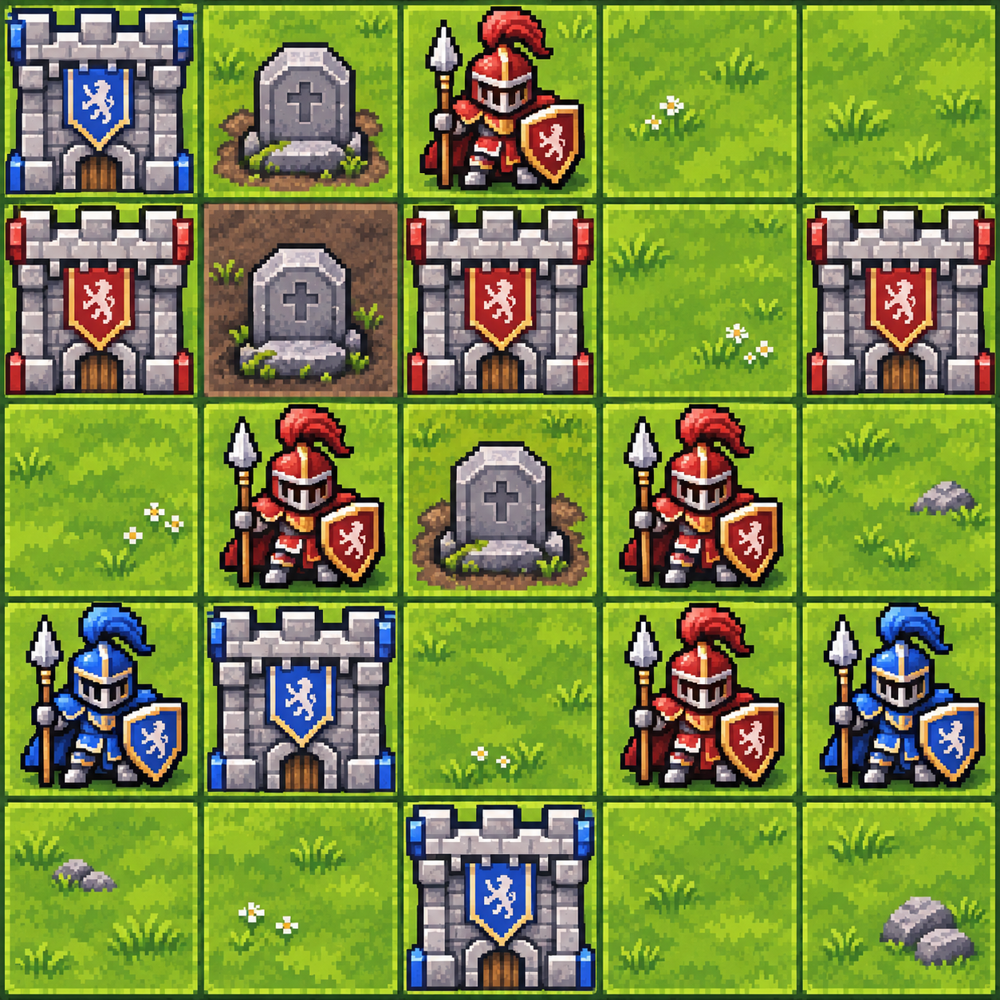

# Castrum Tactics — Art Direction Reference

**Version:** 0.1  
**Status:** Initial visual direction; concept artwork, not production assets  
**Engine:** Godot (C#)  
**Target platforms:** PC and Android

## 1. Visual reference

*Figure 1 — Selected AI-generated concept. This establishes the desired look, not an exact spritesheet or a verified 32×32 pixel grid. Its red and blue factions are illustrative only; faction colors must be configurable.*

## 2. Art direction

- **Style:** Detailed medieval-fantasy pixel art, retaining the approachable retro character of the original game.
- **Perspective:** Direct top-down board with square, non-isometric cells. Piece illustrations may show stylized front/three-quarter detail as long as placement and readability remain clear.
- **Target tile size:** **32×32 source pixels per board cell**, independently of the on-screen display size. This is the current target, to be validated with a real prototype.
- **Rendering:** Crisp pixel edges, nearest-neighbor filtering, consistent pixel density and integer scaling where practical; avoid unintended antialiasing.
- **Visual language:** Strong silhouettes and outlines; cohesive limited palette; readable highlights/shadows; textured but unobtrusive grass; distinct knights, castles, graves, rocks, and rivers.
- **Priority:** Gameplay readability on small Android screens and variable board dimensions takes precedence over decorative detail.

## 3. Faction-color system — implement early

**Decision:** Do not author separate complete red/blue spritesheets. Use **faction-neutral base artwork** and apply the player's selected color at runtime in Godot.

**Preferred technique:** A shader-driven **recolor mask / indexed faction palette**, rather than a global hue shift of the whole sprite. Recolor only designated faction-owned regions (e.g., knight plume, cloth, shield insignia, castle banner). Keep metal, stone, wood, outlines, and neutral shading unchanged. Preserve light/dark tonal differences within recolored regions.

**Asset conventions:**

- Each faction-owned sprite has a shared neutral base and an accompanying recolor mask (or equivalent explicitly defined palette indices).
- Masks and base textures align exactly, use nearest-neighbor sampling, and have no filtering artifacts.
- A single faction color parameter drives all relevant assets; if needed, derive coordinated highlight and shadow colors from it.
- Neutral objects such as graves, rocks, rivers, and ordinary terrain are not faction-tinted by default.
- Avoid embedding red/blue allegiance in the base sprite, except in concept references.

**Game/data conventions:**

- Store **player identity separately from faction color**. Game rules must not rely on Red/Blue being fixed identities.
- Expose faction-color selection early in the UI, initially with a curated palette; design the rendering path to support arbitrary colors later.
- In multiplayer, synchronize the chosen color as presentation metadata; ownership and turn resolution continue to use stable player IDs.
- Prevent or warn about visually indistinguishable player color choices. Consider accessibility: distinguish factions using optional symbols, outlines, or UI labels as well as color.

**Implementation note:** Prototype the shader with one knight and one castle before generating the full asset set. Godot `canvas_item` shaders are a suitable candidate; exact shader/material architecture remains an implementation decision.

## 4. Production asset requirements

- Produce **individual, transparent PNG sprites** or a consistently indexed atlas for units and structures.
- Produce repeatable terrain tiles and test adjacent tile boundaries; rivers/terrain transitions may need multiple variants.
- Keep each sprite aligned to a consistent 32×32 cell coordinate system; use a documented anchor/offset if an illustration extends beyond its cell.
- Separate gameplay overlays (selection, legal moves, ownership, ground health) from decorative artwork so they can change independently.
- Treat generated images as **concepts until manually checked** for pixel-grid accuracy, consistency, transparency, tileability, and in-engine readability.

## 5. Immediate validation milestone

1. Create one 32×32 grass tile, one neutral knight, one neutral castle, and their recolor masks.
2. Render the same knight and castle in at least four selectable faction colors via one shader/material approach.
3. Display them on a small board in Godot at typical PC and Android viewing sizes.
4. Check silhouette clarity, color differentiation, pixel sharpness, and consistency before expanding the tileset.

## 6. Decisions still open

- Final faction-color palette and accessibility options.
- Exact shader-mask encoding and whether palettes or direct tint values are used.
- Tile edge treatment and terrain autotiling strategy.
- Whether 32×32 remains sufficient after the first in-engine readability test.

---

**Reference provenance:** The image in `assets/art-direction-concept-v0.1.png` is an AI-generated concept selected during visual exploration. It is **not** a source of gameplay rules or a production-ready asset sheet.
