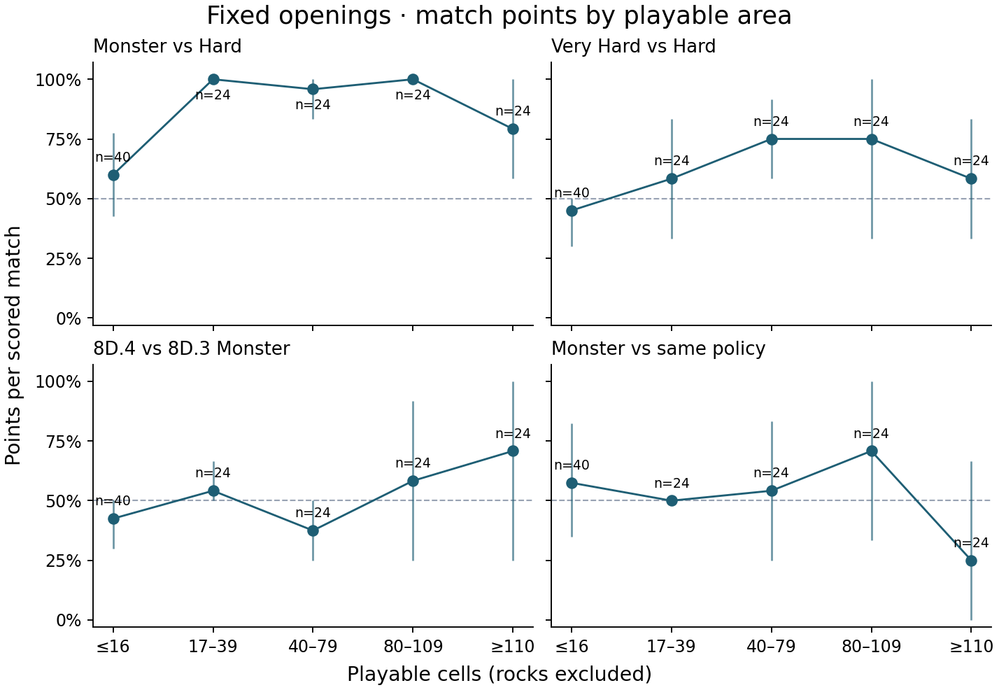

# Milestone 8E battlefield balance

The production catalog contains 100 maps. All 100 accept an authoritative Knight Support draft, reach playable Main in the controlled audit and complete a naturally drafted game in the catalog sweep. The audit identifies configurations that merit a second look before any competitive use. Casual map design can still favor unusual terrain or asymmetry. Catalog assets and map validation remain as shipped in 8D.4. [Map format and catalog](MapFormat.md)

## Catalog and opening fairness

The structural command uses the eight-neighbor geometry of territory and support. It records connected components, components with no draft start, articulation cells, terrain density, start locations, shortest connected start distances and symmetries that preserve terrain and the start set. It previews each eligible first pair in canonical coordinate order. An opening is then completed by colliding on remaining starts, or by claiming opposite ends of the remaining ordered start list. It includes each possible same-square first collision. The output records actual moves, graves and terminal states, and uses authoritative Main legal selections and territory scores. Projected marginal reach counts playable cells within a castle placement range that the opposing castles do not also reach. Shared legal selections and their connected clusters describe immediate contact opportunities. They measure local structure, with no implied long-term value.

The audit tested 7,025 reachable draft paths across the production catalog. 6,212 reached playable Main, 805 required a draft restart and eight finished during draft resolution. Each successful placement round awarded the same number of castles to both sides. The one-castle and more complete drafts frequently differed in legal count and projected reach even when castle counts matched. The path census deliberately induces collisions and does not estimate natural frequencies.

A separate natural sweep used Monster and Hard with independent phase streams and swapped seats. Monster scored **176–7–14** in 197 scored games. Three out of 200 scheduled openings required restart. Crag Cross, Open Meadow and Western Cut each restarted once. With only two games per map, the observed per-map rates are screening signals. A more demanding fixed-start comparison independently swaps seat and physical assignments across 12 maps with one and two castles per side using a predeclared seed. The comparison preserves collision graves and automatic resolutions.

The fixed comparison produced one castle per side: 82–8–6 (89.6%), mean normalized margin +0.172 and two castles per side: 90–0–6 (93.8%), mean normalized margin +0.172. Individual maps saw a single fixed pattern at each castle count. Changing geometry at the same time prevents attribution to castle count alone.

The per-map machine-readable audit is in `Benchmarks/Reference/battlefield-audit-8e.csv`. Its flags suggest repeatable follow-up. Island Keep is the only production map with disconnected terrain and the only map with immediate terminal results in the controlled drafts. Examine reachable alternatives and repeat with strong and varied draft opponents before considering a bridge or alternate start assignment. Crag Cross and Western Cut combine articulation cells with observed restarts. Inspect contact near their flagged cells and repeat masked start comparisons. Crag Cross also averaged roughly 405 Monster pair resolutions in the catalog run. Profile saved Crag Cross snapshots before drawing a responsiveness conclusion. The other articulation routes flagged in the file merit alternate-start sampling if considered for competition. A change to an existing battlefield would require separate approval and an A/B comparison with the original layout.

For future competitive candidates, compare successful settlements under draft denial, multiple physical assignments and policy strength levels, with enough independent seeds to distinguish a recurring effect from a particular draft matchup. Examine conditional match points, score gaps, restarts, access to contested territory, contact, match length and work. Geometry flags guide review. Structural validity, competitive fairness and enjoyment are separate review criteria.

## Battlefield size and stronger-policy consistency

Knight Support resolves a legal action pair deterministically. Uncertainty comes from the other player's concealed selection, mixed strategies and changes in opening assignments. The size study tests whether a stronger policy scores more consistently on larger boards. It cannot quantify a universal share of randomness or skill.

The primary schedule repeats fixed, balanced openings under identical rules across 17 layouts. It uses retired Pocket Meadow (3 × 3, 9 playable cells), Corner Watch (3 × 3, 7 playable cells) and Stone Center (3 × 3, 8 playable cells), four production maps (Open Meadow, Alder Common, Honeystone Green and Twelve Towers) and two generated families from 4 × 4 through 12 × 12. The generated families share four corner starts with opposite corners awarded in the first fixed pair and the remaining two starts colliding in eligibility order. The second family adds a symmetric central block of rocks, 2 × 2 through size 10 and 4 × 4 at size 12. The map generator is deterministic and uses no random layout seed. Distances grow with board width and absolute start count stays fixed. Start density and terrain density can therefore vary with scale. Existing maps supply different obstacles, aspect ratios and draft distributions. All generated maps are selectable only by explicit study ID in Benchmarks.

The fixed and natural schedules use seeds 5501 and 5669 and swap seats. Fixed openings also exchange physical assignments independently. The primary contrasts are frozen 8D.4 Monster against Hard and 8D.3 Monster, Very Hard against Hard, and a same-policy Monster control. A second schedule uses the final Very Hard profile against Hard. The comparison of larger budgets on generated 8 × 8 and 10 × 10 boards uses 2,000 pairs. It uses 4,000 pairs on 12 × 12. Block intervals resample layouts and seed blocks after canonical history deduplication. There are only two generated geometry families, so treating all individual matches as independent or fitting a multivariable size regression would overstate the evidence. Match length and work are reported descriptively. Match length can transmit part of a size effect.

Each fixed cell gives W–D–L, raw points per scored match and canonical distinct histories. The figure shows cluster intervals for the pinned historical contrasts and equal-strength control. The results export also includes mean normalized margin, turns, restart denominators and pairs.

| Playable cells | Monster vs Hard | 8D.4 vs 8D.3 Monster | 8D.4 Very Hard vs Hard | 8E Very Hard vs Hard |
| --- | --- | --- | --- | --- |
| 01–16 | 10–28–2 · 60.0% · 18 | 0–34–6 · 42.5% · 19 | 0–36–4 · 45.0% · 10 | 8–24–8 · 50.0% · 12 |
| 17–39 | 24–0–0 · 100.0% · 12 | 4–18–2 · 54.2% · 12 | 14–0–10 · 58.3% · 12 | 24–0–0 · 100.0% · 12 |
| 40–79 | 22–2–0 · 95.8% · 12 | 2–14–8 · 37.5% · 12 | 18–0–6 · 75.0% · 12 | 20–2–2 · 87.5% · 12 |
| 80–109 | 24–0–0 · 100.0% · 12 | 12–4–8 · 58.3% · 12 | 18–0–6 · 75.0% · 12 | 24–0–0 · 100.0% · 12 |
| 110+ | 18–2–4 · 79.2% · 12 | 14–6–4 · 70.8% · 12 | 14–0–10 · 58.3% · 12 | 20–0–4 · 83.3% · 12 |



In the fixed study, Monster's advantage over Hard increased between the compact stratum and several intermediate strata. The aggregate fell again at 110+ playable cells. The matched open family rose from 75% at 4 × 4 to 100% on 6 × 6 and larger. The corresponding obstructed family rose from 75% to 100% at intermediate sizes and returned to 75% at 12 × 12. The fixed same-policy comparison also swung substantially with its small sample. On the generated 8, 10 and 12 boards, the higher caps reproduced the aggregate Monster–Hard point rates of 100%, 100% and 87.5%. This sensitivity considers two families and 16 scored matches per size. On natural drafts, the newer and older Monster configurations had more draws and restarts than Monster against Hard. Those exclusions matter most on compact and equal-policy schedules.

A separate deviation study replays the first and third Main turns of each available first-seed fixed Monster–Hard assignment. If a turn has more than one legal Monster choice, it selects one alternate legal move by a fixed hash and keeps Hard's realized action. Each resulting board continues with the same two policies. Control and alternate branches use the same three fresh continuation schedules keyed by player and absolute turn. Outcomes and final margins can change as the subsequent choices respond to different board states. The local realized-reply check is not an adversarial search guarantee.

| Playable cells | Layouts / root assignments / branches | Changed W/D/L | Mean absolute margin change per playable cell |
| --- | --- | ---: | ---: |
| 01–16 | 5 / 40 / 120 | 62 (51.7%) | 0.089 |
| 17–39 | 3 / 24 / 72 | 37 (51.4%) | 0.244 |
| 40–79 | 3 / 24 / 72 | 32 (44.4%) | 0.186 |
| 80–109 | 3 / 24 / 72 | 15 (20.8%) | 0.134 |
| 110+ | 3 / 24 / 72 | 25 (34.7%) | 0.103 |

The 408 paired continuations reuse root states and subsequent seeds. These fractions describe sensitivity on the selected matches. An adverse event immediately put Monster below zero in secured margin and below its corresponding control branch. It occurred in 9 treatment continuations, with 8 regaining parity or a lead at least once. All such immediate events were on compact roots. This denominator is too small to compare recovery across sizes, where early secured scores often remain tied even when territory is vulnerable.

The evidence supports a compact-to-intermediate increase in stronger-policy separation for Monster against Hard under these fixed openings. The largest boards, other policy contrasts and individual-action deviations show mixed trends. The general size hypothesis remains inconclusive. In particular, the data do not identify a board-size threshold or show that an individual unpredictable outcome matters less as area increases. The results are consistent with retirement of several compact maps for strategic variety, alongside the earlier playtesting reasons. They do not establish that every retired map is unsuitable.

## Reproduction

Run the calibration tournaments and generated schedules using the [milestone commands](CpuDifficultyCalibration.md#reproduction), then run the audit, sensitivity and reporting commands from the repository root.

```sh
bench=Benchmarks/bin/Release/net10.0/CastrumTactics.Benchmarks.dll
dotnet "$bench" battlefield-audit exports/8e/map-audit.json \
  pocket-meadow corner-watch stone-center three-banners \
  study-open-4 study-open-6 study-open-8 study-open-10 study-open-12 \
  study-block-4 study-block-6 study-block-8 study-block-10 study-block-12
dotnet "$bench" action-sensitivity exports/8e/size-fixed exports/8e/action-sensitivity.jsonl
python3 Benchmarks/Examples/8e/summarize.py exports/8e --audit exports/8e/map-audit.json --out exports/8e/summary.json
python3 Benchmarks/Examples/8e/summarize_audit.py exports/8e/map-audit.json exports/8e/summary.json exports/8e/battlefield-audit.csv
python3 Benchmarks/Examples/8e/plot_size.py exports/8e/summary.json exports/8e/size-study.png
```

The plot command requires Matplotlib. The benchmark results are kept in checksummed local match shards. The checked-in CSV, plot and compact tables retain the reviewed evidence. Full histories, tablebases and device measurements belong under ignored exports or the external benchmark archive. [Historical fixtures and archive](CpuBenchmarks.md#frozen-controls-and-provenance)
