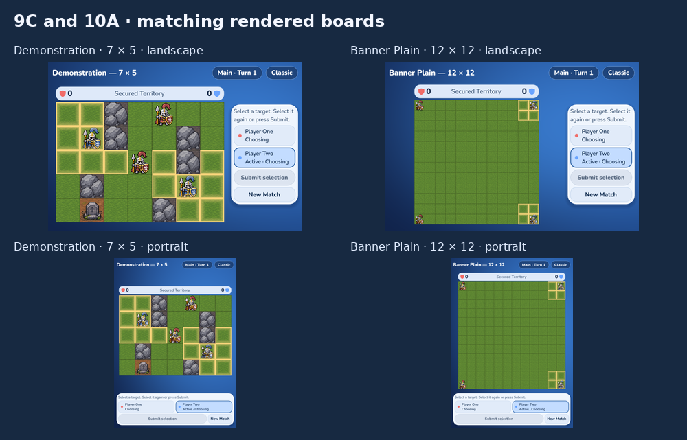

# Milestone 10A verification

The starting point is integrated 9C at `e7b2f7141fb9116628b91e520540b177072901a2` from [PR #26](https://github.com/ChuckreimuHakunorris/castrum-tactics/pull/26). The verified stack uses Godot 4.7.2 .NET and the repository's .NET SDK pin.

[Visual architecture](VisualArchitecture.md) records the ownership and format decisions. The [visual roadmap](VisualDevelopmentRoadmap.md) tracks 10B through 10F. All three reference previews supplied in the review conversation were inspected and recorded in [art direction](ArtDirection.md). The external Windows originals were unavailable. Original format, alpha, provenance and exact extraction remain 10B prerequisites.

## Reproduction

Use the [engineering commands](EngineeringVerification.md#local-commands-and-ci) for build, tests, formatting, archive and documentation checks. The [platform guide](PlatformVerification.md) supplies the two headless presentation commands via the README, plus managed build and export procedures. Compare seeded fixed and natural histories against the integrated baseline using the [9A comparison script](ArchitectureRefactoring.md#reproduction) and a separate output directory for each build and ruleset.

For screenshots, use the same `Tests/Presentation/VisualSnapshotCapture.gd` in both checkouts. Set `CASTRUM_CAPTURE_DIR` to an absolute output path and run `godot --path . --script <path-to-capture-script>` on a rendered display. The script disables background motion for comparable images. It captures the initial draft and completed draft on Demonstration and Banner Plain in both orientations. The [captured comparison](#visual-evidence) uses Linux with the Godot Compatibility renderer and Mesa llvmpipe.

## Visual evidence

All eight pairs matched pixel for pixel at 1080 × 720 landscape and 720 × 1000 portrait. Grid rectangles, piece sprite counts, node counts and Godot resource counts were unchanged in repeated, interleaved runs using the same capture script. Godot's reported static memory increased by about 21 KiB on every sampled board. These are software-rendered, settled-scene observations. They establish no device frame-time or thermal result.

## Behavioral evidence

The baseline solution built without warnings and all 369 tests passed. Both original headless presentation regressions passed. The 10A solution and Release Benchmarks built without warnings. All 389 tests passed (175 Domain, 131 AI and 83 presentation), and both Godot regressions passed with the new sidecar test. The Classic CPU walkthrough still ended 11–12 after 30 Main turns. The archive check verified all 96 protected files. AI sources and profiles, catalog files and historical fixture bytes match the baseline.

The 9A comparison script matched 32 complete histories and 2,571 rounds across Classic and Knight Support with eight games per opening mode and ruleset. It compared full deterministic result payloads with measured-cost fields excluded. Draft order, board rules and benchmark schemas are unchanged. The new resolved-turn object is created only after a live resolution. Main's intermediate board was already produced by the resolver, and hypothetical calls discard the extra output.

The saved 9A history replayed byte for byte and the same record could be inspected with current diagnostics. A rendered development fixture changed the pixels confined to its authored tile in both orientations. The fixture and production board checks use the existing asset bank.

## Warmed CPU samples

Each build ran twice in baseline, candidate, candidate, baseline order. Each batch included 108 warmed observations on nine saved positions per phase with the live 450 ms safeguard. All selected moves matched. Deterministic history comparisons also matched search diagnostics, including pair counts. The ranges below span each build's two runs.

| Phase | 9C median / P95 ms | 10A median / P95 ms | 9C / 10A mean KiB allocated |
| --- | --- | --- | --- |
| Draft | 1.01–1.18 / 13.17–28.79 | 1.01–1.11 / 13.15–14.65 | 159.01 / 159.01 |
| Main | 2.47–2.90 / 49.01–51.18 | 3.68–4.10 / 39.48–40.36 | 404.16–404.89 / 403.80–405.08 |

Allocation averages are similar, and Main median and tail timings moved in opposite directions. These samples share a Linux host and repeat a small position set. They do not isolate a small runtime change. Repeat with the [9A snapshot performance commands](ArchitectureRefactoring.md#reproduction), using the integrated 9C and 10A builds, 12 warmed iterations and alternating build order.

## Platforms and limits

Desktop and Android managed builds passed, including the Android timing compile. The Windows x64 debug executable, pack and managed sidecars were generated and inspected on Linux. The signed ARM64 debug APK passed signature and 16 KiB alignment checks and retained `com.castrumtactics.prototype`, minimum API 24 and target API 36. The export used a disposable local signing key.

Native Windows launch, physical Android installation and play, device rotation and sustained timing remain outstanding. The known Android editor-settings teardown diagnostic appeared during successful runs. The virtual display reported unsupported V-Sync. Neither message prevented the respective verification. Continue with the [platform checklists](PlatformVerification.md) and review the original art files before extraction.
